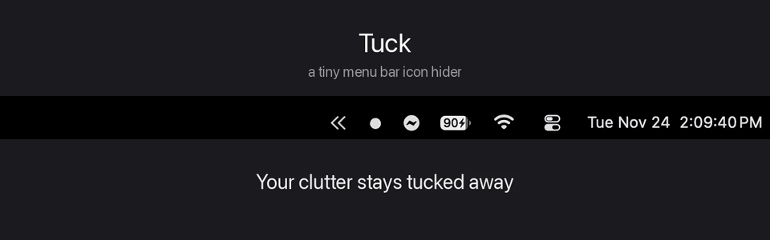

<p align="center">
  
</p>

<h1 align="center">Tuck</h1>

<p align="center">
  A tiny, free menu bar icon hider for macOS.<br>
  One dot. Click it to tuck icons away, click again to bring them back.
</p>

<p align="center">
  <a href="https://github.com/JoshD94/tuck/releases/latest"><b>Download</b></a> ·
  <a href="#install">Install</a> ·
  <a href="#how-to-use">How to use</a> ·
  <a href="#faq">FAQ</a>
</p>

<p align="center">
  
</p>

<p align="center"><sub><a href="docs/demo.mp4">Watch the demo as video</a></sub></p>

## Why

Menu bar apps pile up. Tuck hides the ones you don't need to see, with no account, no settings
window and no background services. It is one ~250-line Swift file you can read in five minutes.

It is built for the menu bar in recent macOS versions (tested on macOS 27), where older hiders
that push icons off-screen no longer work.

## Install

**One line** (recommended). Paste into Terminal:

```sh
curl -fsSL https://raw.githubusercontent.com/JoshD94/tuck/main/install.sh | bash
```

This downloads the latest release into `/Applications` and starts it.

**Or download it yourself:**

1. Download `Tuck.zip` from the [latest release](https://github.com/JoshD94/tuck/releases/latest).
2. Unzip it and drag **Tuck** into **Applications**.
3. Open it. macOS will say it can't verify the developer, because Tuck isn't notarized yet.
   Go to **System Settings → Privacy & Security**, scroll down and click **Open Anyway**.

**Then, either way:** turn Tuck on under **System Settings → Privacy & Security → Accessibility**.
Tuck uses this only to read how wide the current app's menus are, so it knows how much room to
fill. It doesn't read anything else, and it never touches the network.

Requires macOS 14 or later. Runs natively on Apple silicon and Intel.

## How to use

| You see | It means |
|---|---|
| ● filled dot | Icons are tucked away. Click to show them. |
| ○ empty dot | Icons are showing. Click to tuck them away. |
| ◀ triangle | The divider. Everything to its **left** gets tucked away. |

- **Choose what hides:** click the dot so everything shows, then hold **⌘** and drag menu bar
  icons left or right of the triangle.
- **Auto-hide:** shown icons tuck themselves away again after 10 seconds.
- **Settings:** right-click the dot for *Open at Login*, auto-hide, and Quit.

### Automation

Tuck responds to a URL scheme, handy for Raycast, Alfred, Shortcuts or a keyboard shortcut:

```sh
open -g tuck://toggle   # or tuck://show, tuck://hide
```

## How it works

Tuck adds two menu bar items: the dot and the triangle divider just left of it. To tuck icons
away, it stretches the divider to fill exactly the free space between the current app's menus
and the dot. Icons left of the divider no longer fit, so macOS moves them out of the menu bar.
It fills the gap completely, so there's no room left for macOS's own « overflow button either.
When you switch apps (and their menus get wider or narrower), Tuck resizes the divider to match.

Classic hiders stretch the divider to 10,000 points instead. Newer macOS versions drop an item
that wide rather than pushing other icons off-screen, which is why those hiders stopped working.

## FAQ

**An icon I hid is still showing.** Make sure it is left of the triangle, and that Tuck is
allowed under Accessibility. If you just updated Tuck, switch it off and on again there.

**The dot disappeared.** It may be behind the notch on MacBooks with one. Hold ⌘ and drag
other icons to make room, or quit some menu bar apps.

**How do I uninstall it?** Right-click the dot → Quit, then delete `/Applications/Tuck.app`.
If you turned on *Open at Login*, also delete `~/Library/LaunchAgents/com.joshdirga.tuck.plist`.

## Build from source

Needs the Xcode command line tools (`xcode-select --install`).

```sh
git clone https://github.com/JoshD94/tuck.git && cd tuck
scripts/build --install   # universal build into /Applications, then launch
```

The whole app is [`Sources/main.swift`](Sources/main.swift). Rebuilding changes the app's
signature, so turn Tuck off and on again under Accessibility afterwards.

## License

[MIT](LICENSE)
